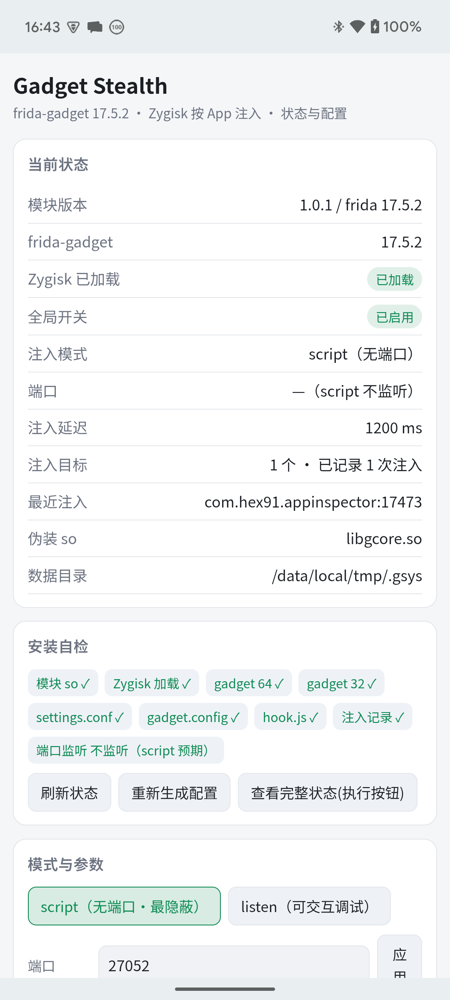
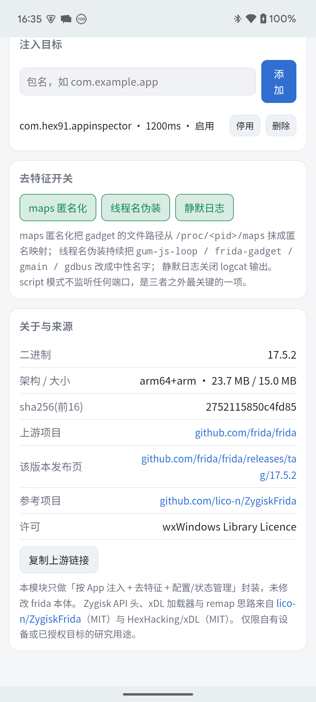

# Gadget Stealth

> 基于 Zygisk 的 **frida-gadget 按 App 持久化注入**模块：版本与 PC / 设备 frida-server 统一到 **17.5.2**，带去特征、可配置、可查看安装状态的完整管理层。

本仓库是独立新工程，参考 [lico-n/ZygiskFrida](https://github.com/lico-n/ZygiskFrida)（MIT）的注入思路，重写了 Zygisk 模块并补齐了版本统一、检测面处理和状态管理。

<p align="center">
  
  
</p>

<p align="center"><sub>Pixel 6 实拍：状态卡 / 安装自检 / 目标管理 / 去特征开关 / 来源信息</sub></p>


---

## 1. 它解决什么

对比原版 ZygiskFrida 与 `frida-server` 常驻方案：

| 维度 | 原版 ZygiskFrida | frida-server 常驻 | **本项目** |
|---|---|---|---|
| gadget 版本 | 内置 17.4.0 | 服务端 17.5.2 | **官方 17.5.2 arm64 + arm**，与 PC 一致 |
| 注入方式 | Zygisk `dlopen` | ptrace 附加 | Zygisk `dlopen`（不 ptrace、不改 APK 签名） |
| 端口 | listen 默认 27042 | 自定义 | **默认 script 模式，零监听端口** |
| maps 痕迹 | 已匿名化 | 守护进程名可扫 | 匿名化 + 中性文件名 + 中性数据目录 |
| 线程名 | 残留 `gum-js-loop` / `frida-gadget` / `gmain` / `gdbus` | — | **持续伪装成 `ThreadPool-<n>`** |
| logcat | 打印 `ZygiskFrida: App detected: ...` | — | **默认完全静默** |
| 配置 | 手动改 JSON | WebUI | `settings.conf` + 命令 + **WebUI** |
| 状态 | 无 | WebUI | **安装自检 / 注入记录 / 版本校验 / WebUI** |
| 目标 App | 需改 JSON | 任意 | 白名单，可增删启停 |

> 与 [frida-persistent-module](https://github.com/hex91/frida-persistent-module) 是互补关系：那个管「整机任意进程临时调试」，这个管「固定 App 长期固定 hook」。两者可同时开机，但**不要用 server 再 attach 已加载 gadget 的进程**（两份 Gum 在同一地址做 inline hook 会互相踩，可能崩溃）。

---

## 2. 版本矩阵（重要）

| 位置 | 版本 | 说明 |
|---|---|---|
| 设备 gadget（本模块） | **frida-gadget 17.5.2** | 官方 `frida/frida` release 资产，arm64 + arm |
| 设备 frida-server | 17.5.2（sijan2 补丁版 android16） | 另一个仓库，可选 |
| PC `frida` | **17.5.2** | 必须与设备端严格一致 |
| PC `frida-tools` | **14.5.2** | 14.11+ 会把 `frida` 连带升到 17.26 搞坏环境 |

```bash
python -m pip install -r requirements.txt
# 等价于
python -m pip install frida==17.5.2 frida-tools==14.5.2
```

设备端 gadget 校验值：

| 资产 | 大小 | sha256 |
|---|---|---|
| `frida-gadget-17.5.2-android-arm64.so`（解压后） | 24,872,296 B | `2752115850c4fd85a239d039aa414a20b29d79eb6082592ee0d816b2917d0f7d` |
| `frida-gadget-17.5.2-android-arm.so`（解压后） | 15,700,304 B | `61b940b7fd149148690273710826d261370e02fa880e7a46c053934512fcf02a` |
| `libgadget-arm64.so.xz`（仓库内压缩包） | 6,809,148 B | `9b4d1da53944b368dd4128670868c14fd29835f7503f63631195c9acd600bff7` |
| `libgadget-arm.so.xz` | 6,000,192 B | `cee44063fe63ec6862bd178819bb17049c7183643fd7020748e18c9093f34981` |

模块安装后，设备侧查看：

```bash
adb shell su -c 'sh /data/adb/modules/zygisk_gadget_stealth/gadget_ctl.sh verify'
```

---

## 3. 安装

前置条件：已 root、Zygisk 实现可用（Zygisk Next / KernelSU + Zygisk / Magisk Zygisk）。实测环境：Pixel 6 / Android 15 / KernelSU + **Zygisk Next 1.5.2**。

```bash
# 1) 下载 Releases 里的 gadget-stealth-1.0.1.zip 并推到手机
adb push gadget-stealth-1.0.1.zip /data/local/tmp/

# 2) 安装（KernelSU / SukiSU）
adb shell su -c 'ksud module install /data/local/tmp/gadget-stealth-1.0.1.zip'
# Magisk 用户在管理器里选「从本地安装」

# 3) 必须重启一次，Zygisk 模块要重启才被加载
adb reboot
```

安装脚本 `customize.sh` 会做这些事：

- 把官方 gadget 解压成 `libgcore.so`(arm64) / `libgcore32.so`(arm) 放到 `/data/local/tmp/.gsys/`，权限 0644（App 进程可读）
- 首次安装写 `settings.conf` 与 `hook.js`；**升级不覆盖已有配置**
- 按 `lib_name` 生成 `<lib_name>.config`（gadget 的行为配置）及 `.config.so` 兼容副本
- 刷新 `module.prop` 的 description，模块卡片上直接能看到版本 / 模式 / 端口 / 目标数

> **SELinux 关键点**：`/data/local/tmp` 下新创建的文件默认是 `u:object_r:shell_data_file:s0`，而 `untrusted_app` 域对它**没有 execute 权限**，直接 `dlopen` 会被内核拒绝（logcat 里是 `avc: denied { execute }`）。所以安装脚本与每次 `reload` 都会执行 `chcon -R u:object_r:system_file:s0`，这也是参考项目能注入成功的原因。手动替换 gadget so 或 hook.js 后，记得执行一次 `reload` 或 `chcon`。

`script` 模式默认 `hook.js` 会在 App 私有目录写 `gs_proof.txt` 作为验证证据；正式部署若不需要这个痕迹，把该文件里的写文件段落删掉即可（或换成自己的 hook 逻辑）。

---

## 4. 配置

配置文件：`/data/local/tmp/.gsys/settings.conf`（纯文本 `key=value`，`#` 注释）。

| 键 | 默认 | 说明 |
|---|---|---|
| `enabled` | `1` | 全局总开关，`0` 完全不注入 |
| `mode` | `script` | `script` 无端口自动跑 hook.js；`listen` 监听端口供交互调试 |
| `port` | `27052` | listen 端口，避开 27042 / 39527；`on_port_conflict=pick-next`、`on_load=resume` |
| `delay_ms` | `1200` | 注入延迟，让 App 启动期的完整性检查先跑完 |
| `lib_name` | `libgcore.so` | 64 位 gadget 的伪装文件名（不含 frida/gadget 字样） |
| `lib_name32` | `libgcore32.so` | 32 位 gadget 文件名 |
| `hide_maps` | `1` | 把 gadget 的 maps 段重映射成匿名内存 |
| `hide_module_map` | `0` | 把 Zygisk 模块自身 so 也匿名化（实验性） |
| `hide_threads` | `1` | 伪装 Gum/GLib 线程名 |
| `no_log` | `1` | 不写 logcat（调试时改 `0`） |
| `write_state` | `1` | 在 App 私有目录写 `.gs_state.<pid>` 供状态面板读取 |
| `thread_alias` | `auto` | `auto` 从一组真实 ART/App 线程名轮换（推荐）；填自定义字符串则用 `<前7字符>-<tid>` |
| `target` | `com.hex91.appinspector,1,1200` | 目标行：`包名,是否启用,延迟ms`，可写多行 |

改完执行 `reload`，然后 **force-stop 并重启目标 App 即可，不用重启手机**：

```bash
adb shell su -c 'sh /data/adb/modules/zygisk_gadget_stealth/gadget_ctl.sh reload'
adb shell am force-stop com.example.app
adb shell monkey -p com.example.app -c android.intent.category.LAUNCHER 1
```

> 数据目录默认 `/data/local/tmp/.gsys`。想换目录：写重定向文件 `/data/local/tmp/.gsys_redirect`（内容为一个绝对路径），或 `gadget_ctl.sh datadir <绝对路径>`；native 模块每次 App 启动都会读这个重定向。

### 关于 `hook.js`

`script` 模式下 gadget 会直接加载 `/data/local/tmp/.gsys/hook.js`，`on_change=reload` 表示改完 App 下次启动自动用新脚本。默认脚本会在 App 私有目录写一条 `gs_proof.txt` 作为「脚本确实执行了」的证据。

> frida 17 起 `Java` bridge 不再内置于 GumJS。脚本里要 `import Java from 'frida-java-bridge'` 并用 `frida-compile` 打包，不能直接写 `Java.perform()`。纯 Native hook 不受影响。

---

## 5. 状态查看（三种入口）

**① 管理器 WebUI**：模块卡片点「打开」。状态卡显示模块/gadget 版本、Zygisk 是否加载、模式、端口、目标与最近注入；自检卡列出模块 so / 两个 gadget / 配置 / 注入记录 / 端口监听；可直接切模式、改端口与延迟、增删启停目标、切去特征开关、点开来源链接。

**② 设备侧命令**：

```bash
CTL=/data/adb/modules/zygisk_gadget_stealth/gadget_ctl.sh
adb shell su -c "sh $CTL status"      # 完整文本面板
adb shell su -c "sh $CTL targets"     # 目标列表
adb shell su -c "sh $CTL verify"      # 版本 / 大小 / sha
adb shell su -c "sh $CTL log"         # logcat（no_log=0 时才有内容）
```

管理器「执行」按钮（`action.sh`）就是调用 `status`。

**③ PC 端**：

```bash
python tools/status.py                 # 状态 + 自检 + 版本
python tools/status.py --check         # 只看自检
python tools/status.py --web           # 直接在手机上打开 WebUI
python tools/status.py --cmd 'add com.foo.bar'
```

`status1` / `check1` / `info1` 是给 WebUI 用的**单行 `key=value`** 协议 —— SukiSU 4.1.0 的 `ksu.exec()` 是同步返回 stdout 最后一行、第二参数是 options 而不是回调，多行输出与回调写法都会导致界面卡死/超时。

### gadget_ctl.sh 子命令速查

| 命令 | 作用 |
|---|---|
| `status` / `status1` | 文本面板 / 单行协议 |
| `check1` | 安装自检（单行） |
| `info1` / `verify` | 版本、来源、校验值 |
| `targets` | 列出目标行 |
| `add <包名>` / `del <包名>` | 增删目标 |
| `enable <包名>` / `disable <包名>` | 启停单个目标 |
| `on` / `off` | 全局开关 |
| `mode script\|listen` | 切模式 |
| `port <数字>` / `delay <毫秒>` | 改端口 / 改延迟 |
| `stealth <键> 0\|1` | 切 `hide_maps` / `hide_module_map` / `hide_threads` / `no_log` / `write_state` |
| `reload` | 重新生成 gadget 配置 + 刷新模块说明 + 清旧状态 |
| `datadir <绝对路径>` | 改数据目录（重定向文件） |
| `log` | 查看模块日志 |

---

## 6. 去特征：做了什么、还剩什么

### 已处理（真机实测）

| 检测面 | 处理 |
|---|---|
| `/proc/<pid>/maps` 里的 so 路径 | `mremap` 重映射为匿名内存，路径消失 |
| 已知路径 `re.zyg.fri` / `libgadget.so` | 换成 `.gsys` / `libgcore.so`，且可自定义 |
| 线程名 `gum-js-loop` / `frida-gadget` / `gmain` / `gdbus` | 守护线程持续改成 `ThreadPool-<tid>` |
| logcat `App detected: <pkg>` | 默认完全不输出 |
| TCP 监听端口 / `/proc/net/tcp` | 默认 `script` 模式，零端口 |
| ptrace / APK 签名 / 完整性校验 | Zygisk 方案天然不涉及 |
| 非目标进程 | 立即 `DLCLOSE_MODULE_LIBRARY`，模块 so 不在无关 App 里驻留 |

### 仍然存在的检测面（如实说明）

- **linker solist**：`dlopen` 后 linker 内部仍记录 so 名，用 xDL 之类遍历 linker 的反检测能看到；maps 匿名化只抹掉 `/proc/maps`。
- **匿名 RX 段**：重映射后在 maps 里表现为来源不明的匿名可执行段，高级检测会按「匿名 r-xp + 大体积」判定可疑。
- **Gum/GLib 行为特征**：线程改名只改 `comm`，JS 引擎的堆特征、`frida` 相关字符串常量仍在内存里。
- **状态文件**：`write_state=1` 会在 App 私有目录留 `.gs_state.<pid>`；极敏感场景可关掉。
- **listen 模式**必然有端口；用 `script` 模式才谈得上「零端口」。

彻底消除这些需要从 frida 源码层改写 gadget，本项目不做，也不声称「过所有检测」。

### 建议组合

1. 稳定 hook 一律用 `script` 模式；开发期临时切 `listen`。
2. `delay_ms` 设 500–3000，避开启动期扫描。
3. 目标白名单只填真正需要的 App。
4. 别用 frida-server 再 attach 已加载 gadget 的进程。
5. 若目标有强反检测，配合关闭 frida-server 的开机自启，减少整机特征。

---

## 7. 与 frida-server 共存

两者路径独立、可以同开：

```bash
adb forward tcp:27052 tcp:27052     # gadget（listen 模式才有）
adb forward tcp:39527 tcp:39527     # server
frida-ps -H 127.0.0.1:27052         # 只看到 Gadget 一个条目
frida-ps -H 127.0.0.1:39527         # 整机进程
```

冲突点只有两个：**端口撞车**（所以用 27052，`pick-next` 兜底）与**同一进程被两份 Gum 同时 hook**。

---

## 8. 从源码编译

只需 Android NDK（实测 r22.1，API 30 wrapper），**不需要 Gradle / Android Studio / prefab / dobby**：

```bash
NDK=/path/to/android-sdk/ndk-bundle bash native/build.sh   # 增量编译，产出 module/zygisk/*.so
python tools/build_zip.py                                  # 产出 dist/gadget-stealth-1.0.1.zip
```

`native/build.sh` 用 NDK 的 clang 直接编译 5 个 xDL C 文件 + 3 个 C++ 文件，静态链接 libc++，导出 `zygisk_module_entry`。所有文本源文件强制 LF（`.gitattributes`），Windows 下 CRLF 会让设备 sh 报错。

源码结构：

```
native/
  main.cpp        Zygisk 入口、注入线程、状态组装
  config.cpp      纯文本配置解析（不引 JSON 库，避免每个 App 启动都解析崩溃）
  stealth.cpp     maps 重映射 / 线程名伪装 / 状态落盘 / 可控日志
  zygisk.h        Zygisk API v2 公共头（来自 Magisk / ZygiskFrida）
  xdl/            HexHacking/xDL（MIT），绕过 linker namespace 强制加载 so
  build.sh        NDK 编译脚本
module/           安装到设备的模块文件（含 webroot WebUI）
gadget/           官方 frida-gadget 17.5.2 xz 压缩包
tools/            打包脚本 + PC 状态查询
docs/
  配置说明.md         全部参数 / 生效条件 / 排错表
  去特征说明.md       检测面清单 / 实测数据 / 仍然存在的检测面
  真机验证报告.md      Pixel 6 完整验证记录
```

---

### 8.1 真机验证摘要

> 仓库已内置编译好的 `module/zygisk/arm64-v8a.so`(2.5 MB) 与 `armeabi-v7a.so`(1.5 MB)，**不装 NDK 也能直接 `python tools/build_zip.py` 出包**；只有改了 `native/` 源码才需要重新编译。

Pixel 6 / Android 15 / KernelSU + Zygisk Next 1.5.2 / SukiSU 4.1.0 上全程实测（完整记录见 `docs/真机验证报告.md`）：

| 项 | 结果 |
|---|---|
| Zygisk 加载 | 64 / 32 位均在 `modules_info` 中 |
| gadget 版本 | `Frida.version = 17.5.2`，与 PC / 设备 server 一致 |
| script 模式 | 脚本自动执行写出 `pid=… frida=17.5.2 arch=arm64 modules=338`，零监听端口 |
| maps | `gadget / frida / libgcore / .gsys / 模块路径` 在 2826 行 maps 中均为 **0** |
| 线程名 | frida 相关 **0** 个，被改成 `pool-2-thread-*` |
| logcat | 本模块 **0** 行 |
| listen 模式 | `frida-ps -H 127.0.0.1:27052` → `Gadget`，脚本加载成功 |
| 双路共存 | server `39527` 与 gadget `27052` 同时工作 |
| 管理层 | `action.sh` / `status.py` / WebUI 状态与交互全部验证通过 |

## 9. 来源与署名

| 项 | 内容 |
|---|---|
| frida-gadget 二进制 | 官方 [frida/frida](https://github.com/frida/frida) · [17.5.2 Release](https://github.com/frida/frida/releases/tag/17.5.2) |
| frida 上游作者 | Ole André V. Ravnås / @oleavr，wxWindows Library Licence |
| 注入思路 / Zygisk API 头 / remap 思路 | [lico-n/ZygiskFrida](https://github.com/lico-n/ZygiskFrida)，MIT（见 `LICENSE.upstream`） |
| linker 强制加载 | [HexHacking/xDL](https://github.com/hexhacking/xDL)，MIT |
| 本仓库新增部分 | 版本统一、去特征增强、配置/状态层、WebUI、编译与打包脚本 |

本仓库**未修改 frida 本体**，只做「按 App 注入 + 去特征 + 配置/状态管理」封装。设备端 frida-server 用的是 sijan2 补丁版，与本模块的 gadget 是两份不同的官方二进制，互不改动。

> 仅限自有设备或已授权目标的安全研究用途。

---

## 10. 常见问题

**装了但状态显示「Zygisk 未加载」**：Zygisk 模块必须重启手机才生效；确认 Zygisk Next 已启用，并查 `su -c 'cat /data/adb/zygisksu/modules_info'` 里有没有 `zygisk_gadget_stealth`。

**改了配置没生效**：要 `reload` 并 **force-stop 重启目标 App**（gadget 只在 App 启动时注入）。改 `settings.conf` 不用重启手机，但装/卸模块必须重启。

**「端口监听」不是 ✗ 而是「不监听（script 预期）」**：这是设计如此。`script` 模式本来就不开端口，自检项用绿色中性样式显示；切到 `listen` 后文字变成「未监听（等 App 启动）」，等目标 App 真正起来才会变 `✓`。

**script 模式怎么确认脚本跑了**：默认 `hook.js` 会在 App 私有目录写 `gs_proof.txt`；`gadget_ctl.sh status` 也会显示 `.gs_state.<pid>` 记录。

**32 位 App 不注入**：需要 `lib_name32` 指向的 32 位 gadget 存在（`check1` 里 `lib32`），且 Zygisk 的 armeabi-v7a.so 被加载。

**WebUI 点按钮没反应 / 超时**：本模块所有 WebUI 命令都是单行同步返回；确认管理器是 SukiSU / KernelSU 且 WebUI 桥接可用（Magisk 无 WebUI，用「执行」按钮或 PC 端 `status.py`）。

**回退**：`su -c 'ksud module uninstall zygisk_gadget_stealth'` 后重启；或 `gadget_ctl.sh off` 立即停用（模块保留）。

---

## 11. 更新日志

**1.0.1**

- WebUI：`script` 模式下「端口监听」不再显示为异常 —— 改用绿色中性样式「不监听（script 预期）」，`listen` 模式下未监听显示「未监听（等 App 启动）」，只有真正该报错的项才标红。
- WebUI：「注入记录」在从未注入时显示「暂无（还没启动目标 App）」，不再标红。
- WebUI：当前状态里的「端口」行在 `script` 模式下写明「—（script 不监听）」。
- 打包：`tools/build_zip.py` 从 `module.prop` 读版本号，产物名随版本自动变。

**1.0.0**

- 首个版本，见 [v1.0.0 Release](https://github.com/hex91/zygisk-gadget-stealth/releases/tag/v1.0.0)。
